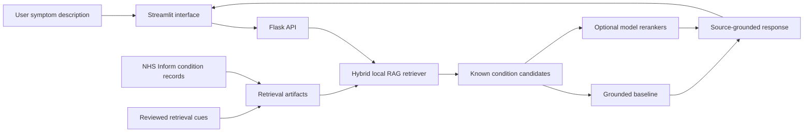

# Medical Condition Assistant

> A source-grounded, educational medical-information assistant built as a graduation project with **AMIT Learning**.

Medical Condition Assistant accepts a free-text description of symptoms, retrieves the closest known conditions from a local knowledge base, and presents the stored symptoms, causes, warnings, and recommendations for the selected record.

It is designed as a data, retrieval, and AI engineering project. It is **not** a diagnostic tool and must not replace a qualified healthcare professional.

## Why this project?

Health-related systems need more than a fluent response. They need a reliable process for deciding where an answer came from. This project addresses that by retrieving a small set of relevant condition records before any model selection happens.

The result is a practical demonstration of how a healthcare-oriented assistant can be designed around:

- A reviewed local condition knowledge base sourced from [NHS Inform](https://www.nhsinform.scot/illnesses-and-conditions/a-to-z/).
- Retrieval-Augmented Generation (RAG) principles, where retrieval is the source of displayed facts.
- A clear Streamlit user interface for entering symptoms and reviewing structured results.
- Reproducible retrieval evaluation instead of unsupported diagnostic-accuracy claims.

## What the user sees

1. The user describes symptoms in natural language.
2. The app retrieves the most relevant known condition records.
3. The selected model can rank only those retrieved candidates.
4. The interface displays the condition's stored symptoms, causes, warnings, and recommendations.

Age and gender may be sent as optional request context. They do not alter medical facts because the current knowledge base does not contain clinically reviewed demographic eligibility rules.

## Architecture



### Grounding rules

- Retrieval happens before a model returns a condition.
- A model can select or rank only conditions already retrieved from the local dataset.
- Symptoms, causes, warnings, and recommendations are read from the selected local record; they are never authored by an LLM.
- If an external model returns an unknown condition, the application uses the top retrieved condition instead.
- Deep-learning checkpoints are protected by a quality guard: weak evaluation results cannot override the top RAG result.

## Project capabilities

| Component | Role |
| --- | --- |
| Grounded FAISS Baseline | Default offline retriever for local condition records. |
| Hybrid retrieval | Word-level TF-IDF + FAISS with character-level TF-IDF to improve matching across short phrases and spelling variation. |
| Logistic Regression | A local notebook-derived model that ranks the retrieved candidate set only. |
| RNN and LSTM | Local sequence-model experiments restricted to the RAG candidate set. |
| Qwen and Mistral | Optional external selectors that can choose only from retrieved candidates. |
| Streamlit UI | User interface for input, model choice, and structured results. |
| Flask API | Local endpoint used by the UI and model adapters. |

## Data and retrieval pipeline

1. Condition pages are collected from the NHS Inform A–Z directory.
2. The records are cleaned and stored in `dataset/usable_dataset.csv`.
3. Reviewed additions can be placed in `dataset/supplemental_conditions.csv`.
4. `dataset/retrieval_cues.csv` contains source-linked phrasing cues used only to improve search matching; it never replaces the displayed medical content.
5. `model_API/train_baseline.py` builds the local hybrid retrieval artifacts.
6. `rag_llm_API/retriever.py` returns ranked records to the API and optional model adapters.

MongoDB and GridFS utilities remain in the repository for the data-collection and legacy model-registry workflows. They are **not required** to run the local application.

## Quick start on Windows

### Requirements

- Windows
- Python 3.10 or newer, available through `py` or `python`
- Internet access on the first run so `pip` can install packages

### One-click setup

1. Clone or download this repository.
2. Double-click `run_the_ChatBot.bat`.
3. The launcher creates `.venv`, installs `requirements.txt`, builds or refreshes the local retrieval artifacts, and starts:
   - Flask API: `http://localhost:5000`
   - Streamlit UI: `http://localhost:8501`
4. Open `http://localhost:8501` in your browser.

The launcher does not download NLTK language data at every startup. The preprocessing service has a local fallback when those optional resources are unavailable.

### Manual setup

```powershell
python -m venv .venv
.\.venv\Scripts\Activate.ps1
python -m pip install --upgrade pip
python -m pip install -r requirements.txt
python model_API\train_baseline.py
python model_API\app.py
```

In a second terminal:

```powershell
.\.venv\Scripts\Activate.ps1
streamlit run gui\app.py
```

## How to use the application

1. Open the Streamlit interface at `http://localhost:8501`.
2. Choose a model. The **Grounded FAISS Baseline** is the recommended offline starting point.
3. Describe symptoms in the text area.
4. Add optional age or gender context if useful.
5. Select **Analyse symptoms**.

The RNN and LSTM entries are experiments. If their checkpoint quality is below the configured threshold, the interface keeps the top RAG record as the displayed result and reports that the quality guard was used.

### Optional Qwen and Mistral paths

Qwen and Mistral are not required for local use. When enabled in the UI, they need an available endpoint:

- **Qwen/Ollama:** the client tries `<base-url>/api/chat` and `<base-url>/api/generate`.
- **Mistral:** use a compatible custom `/generate` endpoint, or `https://api.mistral.ai/v1` with an API key.

Both receive only the local RAG candidates and cannot add a new medical record to the response.

## API endpoints

The local Flask service accepts JSON requests with a non-empty `text` field.

| Endpoint | Purpose |
| --- | --- |
| `GET /health` | Confirms that the API is running and reports local-index availability. |
| `POST /predict` | Runs the grounded retrieval baseline. |
| `POST /predict/logistic-regression` | Uses Logistic Regression to rank the retrieved candidates. |
| `POST /predict/deep-learning` | Uses an RNN or LSTM checkpoint to rank retrieved candidates. |

Example request:

```powershell
Invoke-RestMethod http://localhost:5000/predict `
  -Method Post `
  -ContentType 'application/json' `
  -Body '{"text":"I have wheezing, chest tightness, and shortness of breath."}'
```

## Evaluation

The repository contains a fixed retrieval-regression suite in `evaluation/baseline_regression_cases.csv`. It checks whether known prompts return the intended known condition; it is not a clinical validation study and must not be interpreted as medical diagnostic accuracy.

Run the evaluation after building the virtual environment:

```powershell
.\.venv\Scripts\python.exe model_API\train_baseline.py --force
.\.venv\Scripts\python.exe evaluation\evaluate_baseline.py --top-k 3
```

The latest documented run covers 10 curated cases with 100% Top-1 retrieval, 100% Top-3 recall, and MRR@3 of 1.00. These figures apply only to this small fixed regression suite. See [the evaluation report](reports/experimentation_evaluation_report.md) for scope, cases, and limitations.

## Project structure

```text
Medical_ChatBot/
├── dataset/
│   ├── usable_dataset.csv             # Main local condition knowledge base
│   ├── supplemental_conditions.csv    # Reviewed source additions
│   └── retrieval_cues.csv             # Source-linked search phrasing cues
├── evaluation/                        # Fixed retrieval regression cases and evaluators
├── gui/
│   ├── app.py                         # Streamlit interface
│   └── model_clients.py               # API and optional-model adapters
├── model_API/
│   ├── app.py                         # Flask API
│   ├── train_baseline.py              # Retrieval-artifact builder
│   ├── logistic_regression_notebook.py
│   └── deep_learning_*.py             # RNN/LSTM training and inference support
├── rag_llm_API/
│   ├── retriever.py                   # Shared grounding and retrieval logic
│   └── build_faiss_index.py           # Optional semantic-index builder
├── reports/                           # Evaluation documentation
├── requirements.txt
└── run_the_ChatBot.bat                # Windows launcher
```

## Technology stack

- Python, Flask, Streamlit
- pandas, NumPy, scikit-learn
- TF-IDF and FAISS
- PyTorch for RNN/LSTM experimentation
- NLTK for preprocessing support
- Optional Sentence Transformers, Qwen/Ollama, Mistral, MongoDB, and GridFS integrations

## Current limitations and next steps

- The knowledge base contains one source record per condition in many cases; it is not a patient-level clinical dataset.
- The regression suite is small and curated. It does not measure real-world diagnostic performance, safety, fairness, or population-level usefulness.
- The current system returns nearest records and has no calibrated abstention rule for unrelated or uncertain prompts.
- A future iteration should add clinician-reviewed evaluation cases, emergency and out-of-domain prompts, source citations in the UI, and an explicit uncertainty/abstention workflow.

## Safety notice

This project is for educational and portfolio purposes only. It does not provide medical diagnosis, treatment, or emergency guidance. For severe, urgent, or life-threatening symptoms, contact local emergency services or a qualified healthcare professional.

## License

Shared for educational and portfolio use.
